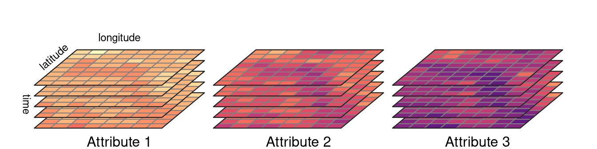
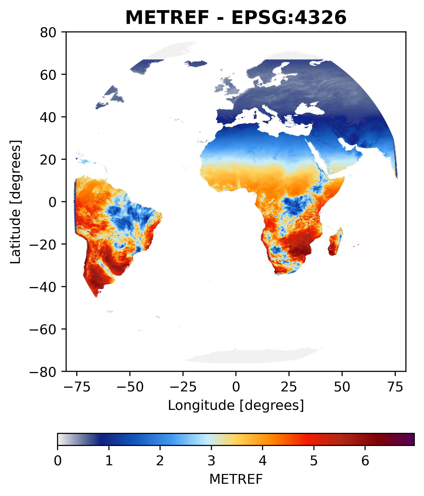
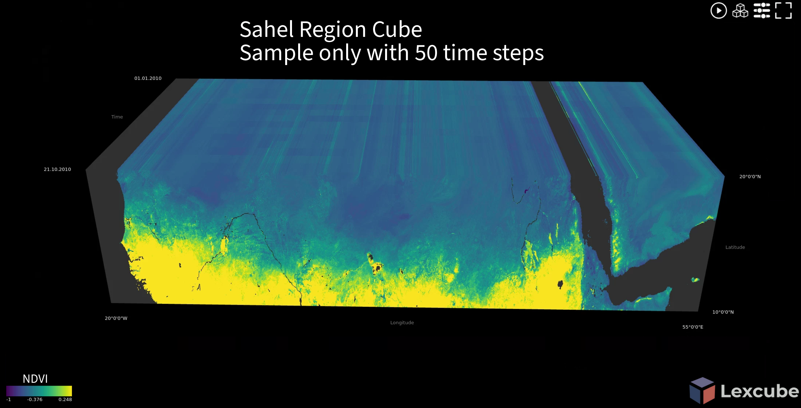
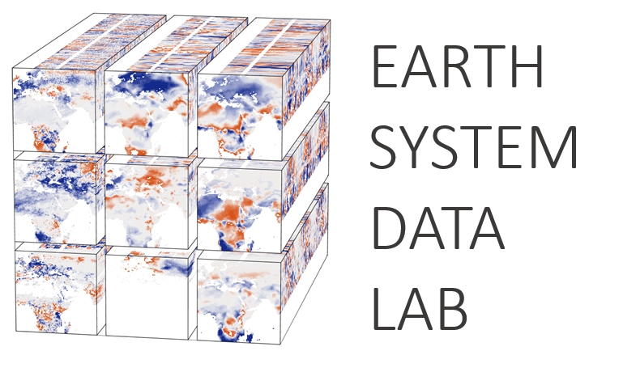

## {.hero}

::: {.hero-grid}
::: {.cube-3d}
::: {.cube-3d-inner}
[]{.f .front} []{.f .back} []{.f .right} []{.f .left} []{.f .top} []{.f .bottom}

Source: [Claude](claude.ai) and [Khizer Zakir](https://khizerzakir.github.io)
:::
:::

::: {.hero-text}
[One month · one region · one cube]{.kicker}

::: {.fragment .fade-up}
[30]{.stat} daily NetCDF files
:::

::: {.fragment .fade-up}
[1]{.stat} Zarr store, compressed and chunked
:::

::: {.fragment .fade-up}
[1 line]{.stat} to open it and select by date and place
:::
:::
:::

::: {.notes}
Press F for full screen, S for speaker notes, T toggles light/dark, C opens the chalkboard, M the menu.
:::

## Agenda {.agenda}

::: {.agenda-grid}
::: {.agenda-item .fragment .fade-up}
[1]{.num} **What is a climate cube?**
:::
::: {.agenda-item .fragment .fade-up}
[2]{.num} **Why build one?**
:::
::: {.agenda-item .fragment .fade-up}
[3]{.num} **Our approach**
:::
::: {.agenda-item .fragment .fade-up}
[4]{.num} **Hands-on walkthrough** - WSL → download → CDO → Zarr → notebooks
:::
::: {.agenda-item .fragment .fade-up}
[5]{.num} **Caveats & scaling**
:::
::: {.agenda-item .fragment .fade-up}
[6]{.num} **Wrap-up & resources**
:::
:::

<!-- ======================================================= -->
# 1 · What is a climate cube? {background-color="#0b1f33"}

Dimensions, variables and the idea behind the cube

## Many files… {auto-animate="true"}

::: {.file-stage}
[NETCDF4_…20150601.nc]{.file data-id="f1" style="left:4%;top:8%;transform:rotate(-6deg)"}
[NETCDF4_…20150602.nc]{.file data-id="f2" style="left:52%;top:3%;transform:rotate(4deg)"}
[NETCDF4_…20150603.nc]{.file data-id="f3" style="left:28%;top:30%;transform:rotate(-2deg)"}
[NETCDF4_…20150604.nc]{.file data-id="f4" style="left:66%;top:38%;transform:rotate(7deg)"}
[NETCDF4_…20150605.nc]{.file data-id="f5" style="left:8%;top:56%;transform:rotate(3deg)"}
[NETCDF4_…20150606.nc]{.file data-id="f6" style="left:44%;top:64%;transform:rotate(-5deg)"}
:::

::: {.caption-bottom}
Each file: one date, the full MSG disk (3201 × 3201), packed integers, its own metadata.
:::

## … one cube {auto-animate="true"}

::: {.file-stage}
[2015-06-01]{.file .layer data-id="f1" style="left:30%;top:58%"}
[2015-06-02]{.file .layer data-id="f2" style="left:32.5%;top:50%"}
[2015-06-03]{.file .layer data-id="f3" style="left:35%;top:42%"}
[2015-06-04]{.file .layer data-id="f4" style="left:37.5%;top:34%"}
[2015-06-05]{.file .layer data-id="f5" style="left:40%;top:26%"}
[2015-06-06]{.file .layer data-id="f6" style="left:42.5%;top:18%"}
[time →]{.axis style="left:66%;top:16%"}
[lon →]{.axis style="left:36%;top:84%"}
[lat ↑]{.axis style="left:18%;top:62%"}
:::

::: {.caption-bottom}
**A data cube** = one grid, one time axis, named variables: `METREF(time, lat, lon)`, `quality_flag(time, lat, lon)`.
:::

## What is a climate data cube?

::::: columns
::: {.column width="62%"}
A **data cube** organises data along shared dimensions. For climate/EO variables, typically:

```text
variable(time, latitude, longitude)
```

::: {.fragment .fade-up}
- **Harmonised:** one grid, one calendar, consistent units and metadata.
- **Analysis-ready:** select by label (`time="2015-06-15"`), not by file.
- **Not a file format:** the *organisation* is the cube; here NetCDF is the input and **Zarr** the storage.
:::
:::
::: {.column width="38%"}
[{width="100%"}](https://tmap.geocompx.org/geodata.html#fig-raster-data-cubes)

<small>Image: [tmap — geocompx](https://tmap.geocompx.org/geodata.html#fig-raster-data-cubes)</small>
:::
:::::

## From a disk image to a regional cube

::::: columns
::: {.column width="40%"}
{height="500px"}
:::
::: {.column width="60%" .fragment .fade-left}
{width="100%"}

::: {.small-note}

Left: what the provider delivers — one file per day. 

Right: what analysis wants — a region, stacked in time.
:::
:::
:::::

## Cubes in practice

::: {.cube-grid}

::: {.cube-card .fragment .fade-up}
{width="100%" style="background:#fff;padding:5px;border-radius:12px;"}

Harmonised Earth-system variables on a common grid.

[Open the viewer](https://viewer.earthsystemdatalab.net/)
:::

::: {.cube-card .fragment .fade-up}
{width="100%" style="background:#fff;padding:5px;border-radius:12px;"}

Open-source software to manage and analyse EO data cubes.

[ODC website](https://www.opendatacube.org/)
:::

::: {.cube-card .fragment .fade-up}
{width="100%" style="background:#fff;padding:5px;border-radius:12px;"}

Community stack for cloud-native geoscience: Xarray, Dask and Zarr.

[Pangeo Ecosystem](https://pangeo.io/)
:::

::: {.cube-card .fragment .fade-up}
{width="100%" style="background:#fff;padding:5px;border-radius:12px;"}

Python toolkit to generate and serve analysis-ready cubes.

[xcube Viewer](https://xcube-dev.github.io/xcube-viewer/)
:::

:::

::: {.notes}
Different communities, same idea: a consistent, labelled, multidimensional structure.
:::

<!-- ======================================================= -->
# 2 · Why build one? {background-color="#0b1f33"}

And why use a cube at all?

## Why are we here?

:::: {.fragment .fade-down}
::: card
Climate products are useful, but files arrive with different grids, time steps, packing, metadata and quality flags.
:::
::::

:::: {.fragment .fade-up}
::: card
Today we build one small, transparent path from EUMETSAT LSA SAF files to a regional data cube.
:::
::::

:::: {.fragment .fade-down}
::: card

Every step leaves an output you can open and check

and every choice is written down.
:::
::::

<!-- ## Many files vs one cube

| Many separate files | One cube |
|---|---|
| Different grids, time steps and naming | One grid, one time axis, named variables |
| Open and loop over files | Open once, select by label (`time`, `lat`, `lon`) |
| Read whole files | Read only the chunks you need |
| Processing choices live in scripts and memory | Choices stored with the data (`zarr_cube_*` attributes) |

: {.striped .hover} -->

## Where a cube fits in the ecosystem

::: {.ecosystem-grid}

::: {.cube-card}


**Describe**
Standardise metadata for discovering geospatial assets.
:::

::: {.cube-card}


**Discover and process**
Access open datasets through STAC and use hosted compute.
:::

::: {.cube-card}


**Analyse**
Use a managed platform for large-scale geospatial analysis.
:::

::: {.cube-card}
{width="100%"}

**Store**
Save chunked, compressed multidimensional arrays.
:::

::: {.cube-card}


**Work with data**
Select, transform and analyse labelled arrays in Python.
:::

:::

::: {.notes}
STAC describes and helps discover assets; it is not a data cube format. Planetary Computer and Earth Engine are hosted platforms. Zarr is a storage format, Xarray a Python library.
:::

## Where does our data come from? {.smaller}

:::: {.columns}
::: {.column width="25%"}
{width="100%" style="background:#fff;padding:5px;border-radius:5px;"}

{width="100%" style="background:#fff;padding:5px;border-radius:5px;"}
:::
::: {.column width="75%"}
| Product | What it represents | In this tutorial |
|---|---|---|
| **METREF** | Reference evapotranspiration (mm/day) | Default sample |
| **MDFVC** | Fractional vegetation cover | Second product: own URL, own folder |

Authenticated [LSA SAF Data Service](https://datalsasaf.lsasvcs.ipma.pt/). Versions, units, coverage and QA differ by product --- read the product page first.
:::
::::

<!-- ======================================================= -->
# 3 · Our approach {background-color="#0b1f33"}

What we will follow in this tutorial

## Three scripts, three folders

::: {.pipe}
::: {.pipe-stage .fragment .fade-up}
[☁️]{.ico}
**LSA SAF**

credentials in `code/.env`
:::

[→]{.pipe-arrow .fragment .fade-in}

::: {.pipe-stage .fragment .fade-up}
[①]{.ico}
**`01_download_sample.sh`**

`data/raw/METREF/2015/06/`
:::

[→]{.pipe-arrow .fragment .fade-in}

::: {.pipe-stage .fragment .fade-up}
[②]{.ico}
**`02_preprocess_cdo.sh`**

`data/interim/METREF/…`
:::

[→]{.pipe-arrow .fragment .fade-in}

::: {.pipe-stage .fragment .fade-up}
[③]{.ico}
**`03_build_zarr_cube.py`**

`data/zarr/metref_cube.zarr`
:::

[→]{.pipe-arrow .fragment .fade-in}

::: {.pipe-stage .fragment .fade-up}
[④]{.ico}
**notebooks + `plot_utils`**

maps · time series · zones
:::
:::

::: {.fragment .fade-up .center-note}
Each stage writes **its own folder**. If something looks wrong, open the previous folder and check there.
:::

## Three principles

::::: columns
::: {.column width="33%" .fragment .fade-up}
::: card
**Small first**

One product, one month, one region.
:::
:::
::: {.column width="33%" .fragment .fade-up}
::: card
**Explicit**

Bounds, grid, resampling and chunking are written down.
:::
:::
::: {.column width="33%" .fragment .fade-up}
::: card
**Checkable**

Every stage leaves an output you can inspect.
:::
:::
:::::

::: {.fragment .fade-up style="margin-top:1em"}
APIs and hosted platforms (Planetary Computer, Earth Engine) are great for discovery and analysis. This workflow is the local, fully documented path for authenticated LSA SAF data --- the two complement each other rather than competing.
:::

<!-- ======================================================= -->
# 4 · Hands-on walkthrough {background-color="#0b1f33"}

Follow along on the [tutorial site](https://khizerzakir.github.io/tutorial-repo/) --- or generate your commands with the [command builder](https://khizerzakir.github.io/tutorial-repo/tutorial/reference.html)

## Step 0 · Open a Linux shell {auto-animate="true"}

::::: columns
::: {.column width="40%"}
**Windows → WSL2 (once, admin PowerShell)**

```powershell
wsl --install -d Ubuntu
```

**Every session**

- Start menu → **Ubuntu**, or
- Windows Terminal → ⌄ → **Ubuntu**

[Keep the project in `~/`, not `/mnt/c/` --- much faster.]{.small-note}
:::
::: {.column width="60%"}
::: {.terminal}
```{.bash code-line-numbers="1-2|3-4|5-7|8"}
sudo apt update
sudo apt install -y git wget cdo
curl -LsSf https://astral.sh/uv/install.sh | sh
source "$HOME/.local/bin/env"
mkdir -p ~/projects && cd ~/projects
git clone https://github.com/khizerzakir/tutorial-repo.git
cd tutorial-repo
uv sync --locked --extra notebook
```
:::
:::
:::::

## Step 0 · Credentials stay local

::::: columns
::: {.column width="50%"}
```bash
cp code/.env.example code/.env
nano code/.env
```

```{.dotenv code-line-numbers="1-2|3-4|5-6"}
LSASAF_USERNAME="your_username"
LSASAF_PASSWORD="your_password"
SAMPLE_YEAR=2015
SAMPLE_MONTH=06
VARIABLE_NAME=METREF
URL="https://datalsasaf.lsasvcs.ipma.pt/PRODUCTS/MSG/METREF/NETCDF"
```
:::
::: {.column width="50%" .fragment .fade-left}
::: card
`code/.env` is in `.gitignore`.

The downloader writes the password to a **temporary wgetrc** that is deleted on exit --- it never appears in the process list or shell history.
:::

::: {.checkpoint}
**Checkpoint:** `uv run python -c "import zarr; print(zarr.__version__)"` → `3.x`
:::
:::
:::::

## Step 1 · Download {auto-animate="true" .big-code}

```{.bash}
bash code/01_download_sample.sh
```

::: {.small-note}
Uses month, product and URL from `code/.env`.
:::

## Step 1 · Download {auto-animate="true" .big-code}

```{.bash}
bash code/01_download_sample.sh 2015 06
```

::: {.small-note}
Arguments **override** `.env`: year and month first …
:::

## Step 1 · Download {auto-animate="true" .big-code}

```{.bash}
bash code/01_download_sample.sh 2015 06 MDFVC \
  "https://datalsasaf.lsasvcs.ipma.pt/PRODUCTS/MSG/MDFVC/NETCDF"
```

::: {.small-note}
… then folder name and product URL --- a second product without editing `.env`.
:::

## Step 1 · Download {auto-animate="true" .big-code}

```{.bash}
JOBS=8 bash code/01_download_sample.sh 2015 06 MDFVC \
  "https://datalsasaf.lsasvcs.ipma.pt/PRODUCTS/MSG/MDFVC/NETCDF"
```

::: {.terminal-out}
::: {.fragment}
`2015-06: 30 file(s) on server, 30 to download -> data/raw/MDFVC/2015/06`
:::
::: {.fragment}
`First file: ~6s. Estimated remaining: ~0m22s with 8 parallel jobs`
:::
::: {.fragment}
`Done: 30 file(s) in 0m29s`
:::
:::

::: {.small-note .fragment}
`JOBS` = parallel downloads. Re-run any time: existing files are skipped, failed ones retried.
:::

## Download · inside the script

```{.bash code-line-numbers="1-2|3-4|6-8|10-11|12"}
ENV_FILE="${ENV_FILE:-$PWD/code/.env}"
set -a; . "$ENV_FILE"; set +a
WGETRC="$(mktemp)"; export WGETRC; trap 'rm -f "$WGETRC"' EXIT
printf 'http_user=%s\nhttp_password=%s\n' "$LSASAF_USERNAME" "$LSASAF_PASSWORD" > "$WGETRC"

for d in $(seq -w 1 31); do                         # list every day folder of the month
  list+=$(wget -q -O- "$SRC/$YEAR/$MONTH/$d/" | grep -E '\.nc$' …)
done

get() { wget -q -O "$f.part" "$1" && mv "$f.part" "$f"; }    # .part → rename when complete
t0=$SECONDS; get "$(head -n1 <<< "$pending")" "$DEST"        # time one file → estimate
tail -n +2 <<< "$pending" | xargs -P "$JOBS" -I{} bash -c 'get "$1" "$2"' _ {} "$DEST"
```

::: {.notes}
Simplified excerpt; the real script adds retries, timeouts and reports failures. Walk through with the arrow keys: credentials → listing → safe download → parallel.
:::

## Step 1b · Look before you remap

```{.bash code-line-numbers="1|2|3|4"}
cdo -s showname data/raw/METREF/2015/06/*0601*.nc   # METREF quality_flag
cdo -s sinfo    data/raw/METREF/2015/06/*0601*.nc   # lonlat 3201x3201, -80…80 by 0.05
cdo -s showtimestamp data/raw/METREF/2015/06/*0601*.nc
cdo -s infon    data/raw/METREF/2015/06/*0601*.nc   # min / mean / max, missing count
```

::::: columns
::: {.column width="50%" .fragment}
::: card
`showname` gives you **`MAIN_VARIABLE`** and **`QA_VARIABLES`** for the next step.
:::
:::
::: {.column width="50%" .fragment}
::: card
Raw values are **packed** (`int16` × `scale_factor`, `_FillValue`). xarray and CDO decode them --- check that they do.
:::
:::
:::::

## Step 2 · Snap the region to the source grid {auto-animate="true"}

::::: columns
::: {.column width="55%"}
::: {.grid-demo}
[]{.aoi data-id="aoi" style="left:23%;top:17%;width:47%;height:51%"}
:::
:::
::: {.column width="45%"}
Your AOI comes from the YAML `domain:` **or** a vector file (`.geojson`, `.gpkg`, `.shp`, `.parquet`).

Its bounds rarely fall on cell edges …
:::
:::::

## Step 2 · Snap the region to the source grid {auto-animate="true"}

::::: columns
::: {.column width="55%"}
::: {.grid-demo}
[]{.aoi .snapped data-id="aoi" style="left:20%;top:10%;width:50%;height:60%"}
:::
:::
::: {.column width="45%"}
… so `snap_aoi_to_netcdf_grid.py` expands them **outward to whole raw cells**, writes `grid.txt` and updates the YAML.

::: {.fragment}
- Target cell size **= raw cell size** (0.05°): no invented detail.
- Crop = grid + `buffer` (0.2°) so bilinear has neighbours at the edge.
:::
:::
:::::

## Step 2 · Crop and remap {auto-animate="true" .big-code}

```{.bash}
MAIN_VARIABLE=METREF uv run bash code/02_preprocess_cdo.sh
```

::: {.small-note}
`MAIN_VARIABLE` is required and checked against `cdo showname`. `uv run` gives the script's internal `python3` the project packages.
:::

## Step 2 · Crop and remap {auto-animate="true" .big-code}

```{.bash}
MAIN_VARIABLE=METREF QA_VARIABLES=quality_flag \
  uv run bash code/02_preprocess_cdo.sh 0.05 data/raw/METREF data/interim/METREF
```

::: {.small-note}
Arguments: resolution label (log) · input folder · **output folder per product**.
:::

## Step 2 · Crop and remap {auto-animate="true" .big-code}

```{.bash}
MAIN_VARIABLE=METREF QA_VARIABLES=quality_flag \
  uv run bash code/02_preprocess_cdo.sh 0.05 data/raw/METREF data/interim/METREF \
  data/aoi/spatial_units.geosjon
```

::::: columns
::: {.column width="50%"}
::: {.small-note}
4th argument: a vector AOI instead of the YAML box.
:::
:::
::: {.column width="50%" .fragment}
```{.yaml}
processing:
  parallel: 4            # files at once (not an env var)
  remap_method: bilinear # or nearest
  buffer: 0.2
```
:::
:::::

## Processing · one file's journey

```{.bash code-line-numbers="1|2-3|4|5|6|7"}
cdo -sellonlatbox,$W,$E,$S,$N          in.nc    clip.nc        # crop (+ buffer)
cdo -delname,$QA_CSV                   clip.nc  main.nc        # continuous variables
cdo -selname,$QA_CSV                   clip.nc  qa.nc          # flags
cdo -remapbil,grid.txt                 main.nc  main_r.nc      # smooth → bilinear
cdo -remapnn,grid.txt                  qa.nc    qa_r.nc        # codes → nearest, never averaged
cdo merge main_r.nc qa_r.nc merged.nc                          # back together
cdo -s sinfo merged.nc && mv merged.nc out.part && mv out.part out_processed.nc  # only valid output lands
```

::: {.small-note .fragment}
`processing.parallel` files run at once through `xargs -P`; results and failures go to `data/interim/METREF/cdo.log`.
:::

## Resampling is a decision

| Method | Typical use | Main trade-off |
|---|---|---|
| Bilinear | Continuous fields (ETo, temperature, FVC) | Smooths; can shrink extremes |
| Nearest neighbour | Categories, QA flags | Preserves classes; looks blocky |

::: {.fragment .fade-up}
Neither creates finer detail than the source. Choose per product, keep the QA flags, and **record the choice**.
:::

::: {.checkpoint .fragment}
**Checkpoint:** one `*_processed.nc` per raw file · no `status=failed` in `cdo.log` · `cdo sinfo` shows the `grid.txt` size
:::

## Step 3 · Build the cube {auto-animate="true" .big-code}

```{.bash}
uv run python code/03_build_zarr_cube.py --input data/interim/METREF --dry-run
```

::: {.terminal-out}
```text
Profile          : map
Files            : 30  (…201506010000_processed.nc … …201506300000_processed.nc)
Variables        : METREF, quality_flag
Dimensions       : {'time': 30, 'lat': 91, 'lon': 121}
Inner chunk      : {'time': 1, 'lat': 91, 'lon': 121}  (~43.0 KB raw each)
Shard            : {'time': 10, 'lat': 91, 'lon': 121}
Per variable     : 30 inner chunks in 3 shard object(s)
Dry run: nothing written.
```
:::

## Step 3 · Build the cube {auto-animate="true" .big-code}

```{.bash}
uv run python code/03_build_zarr_cube.py --input data/interim/METREF
```

::: {.terminal-out}
::: {.fragment}
`Validation OK    : first/last time steps match the interim NetCDF`
:::
::: {.fragment}
`Valid fraction   : METREF=95.9%, quality_flag=100.0%`
:::
::: {.fragment}
`Stored size      : 841.8 KB in 15 files (compression ≈ 2.3× vs 1.9 MB in memory)`
:::
:::

## Step 3 · Flags you will actually use

```{.bash code-line-numbers="1|2|3|4|5"}
uv run python code/03_build_zarr_cube.py --input data/interim/METREF --profile timeseries
uv run python code/03_build_zarr_cube.py --input data/interim/METREF --append
uv run python code/03_build_zarr_cube.py --input data/interim/METREF --variables METREF --float32
uv run python code/03_build_zarr_cube.py --input data/interim/METREF --chunks time=4,lat=64,lon=64
uv run python code/03_build_zarr_cube.py --input data/interim/METREF --workers 2 --clevel 7
```

::: {.small-note}
1 layout for point time series · 2 add next month without rebuilding · 3 keep one variable, halve float64 · 4 custom chunks · 5 limit CPU, compress harder.
:::

## Chunks · shards · compression

```{.python code-line-numbers="1-5|7-9|11-14"}
PROFILES = {   # inner chunk                              shard
  "map":        ({"time": 1,  "lat": 256, "lon": 256}, {"time": 10,  "lat": 512, "lon": 512}),
  "balanced":   ({"time": 8,  "lat": 128, "lon": 128}, {"time": 32,  "lat": 512, "lon": 512}),
  "timeseries": ({"time": 64, "lat": 32,  "lon": 32},  {"time": 256, "lat": 256, "lon": 256}),
}

c = min(inner[dim], size)                          # clamp chunk to the data
k = min(round(shard[dim] / c), ceil(size / c))     # shard = whole number of chunks
inner[dim], shard[dim] = c, c * k                  # (Zarr v3 sharding requires this)

ds = ds.chunk(shard)                               # one Dask task = one whole shard
encoding[var] = {"chunks": inner, "shards": shard,
                 "compressors": [BloscCodec(cname="zstd", clevel=5, shuffle="shuffle")]}
ds.to_zarr(tmp, zarr_format=3, encoding=encoding, consolidated=True)
```

::: {.notes}
The rounding fixes a real failure: a 300 × 400 AOI with 256-cell chunks and 512 shards would otherwise produce a shard that is not divisible by the chunk and Zarr refuses to write.
:::

## Try it · which queries are cheap? {.explorer-slide}



## Step 4 · Open and explore

```{.python code-line-numbers="1-2|4|5|6|8-11"}
import xarray as xr
ds = xr.open_zarr("data/zarr/metref_cube.zarr")      # consolidated: one metadata read

day_map = ds.METREF.sel(time="2015-06-15")                       # by label, not by file
series  = ds.METREF.sel(lon=-16.4, lat=14.5, method="nearest")   # one pixel, all dates
monthly = ds.METREF.resample(time="1MS").sum()                    # lazy until plotted

import sys; sys.path.insert(0, "code/plot_utils")
from adaptive_cube_plot import plot_time_slices, plot_spatial_timeseries
plot_time_slices(ds, var="METREF", time_index=[0, 14, 29], boundaries=units, robust=True)
plot_spatial_timeseries(ds, var="METREF", points={"Dakar": (-17.19, 14.75)}, show_area_spread=True)
```

## Step 4 · Three notebooks

::::: columns
::: {.column width="33%" .fragment .fade-up}
::: card
**1 · Validate**

Quick data validation at convenience.

:::
:::
::: {.column width="33%" .fragment .fade-up}
::: card
**2 · Plot**

Some quick visualisations of the cube: maps, time series, zonal stats.
:::
:::
::: {.column width="33%" .fragment .fade-up}
::: card
**3 · Application**

A specific use case, if time allows, we can explore this in detail.
:::
:::
:::::

::: {.fragment .fade-up .center-note}
17 million mobility rows → **one half-month read** with Parquet `filters=` (predicate push-down).
:::

## QA · what should we check?

- Source vs output: coordinates, timestamps, units, variable names.
- Decoded fill values and valid-cell fraction --- per date, not just overall.
- Missing-data footprint vs the product mask and QA flags.
- A few known values and summary statistics, raw → interim → cube.

::: {.fragment .fade-up}
**A file that opens is not automatically fit for analysis.**
:::

<!-- ======================================================= -->
# 5 · Caveats & scaling {background-color="#0b1f33"}

What the cube does not solve

## Caveats and uncertainty

- Missing values may be real masks/QA exclusions --- or configuration problems.
- A crop/grid mismatch, wrong variable or undecoded fill value can create extensive NaNs.
- Bilinear smooths; nearest is blocky. Different choices change statistics.
- Degree grids have latitude-dependent ground size.
- Product versions, temporal support, units and QA systems differ.
- This is a **training/small-scale workflow**, not a validated operational product.

## On-the-fly processing vs a pre-built cube

| | On-the-fly (catalog + lazy loading) | Pre-built cube (this tutorial) |
|---|---|---|
| Regridding | At read time; settings easy to overlook | Fixed once and documented |
| Compute cost | Paid at every query | Paid once, up front |
| Storage | Reuses the provider's data | Creates a derived copy |
| Change area/grid/method | Change the query | Re-run the pipeline |
| Provider updates | Automatic | `--append` / rebuild |

Neither is better in general --- choose by use case and always record the resampling choice.

## Scale the pilot carefully

- Benchmark a representative subset: runtime, peak memory, size, valid coverage, **read speed of your real queries**.
- Grow in **time batches** with `--append`; split very large areas into grid-aligned tiles with a remap margin.
- Parallelise within measured CPU, memory and disk limits (`processing.parallel`, `JOBS`, `--workers`).
- Choose the chunk profile for the dominant question; re-benchmark at scale.

::: {.fragment .fade-up}
Do not scale only by adding workers --- disk throughput, memory and object counts become the bottleneck.
:::

<!-- ======================================================= -->
# 6 · Key message {background-color="#0b1f33"}

## What we learned {.center}

::: {.big-message .fragment .zoom-in}
A useful climate cube starts with **consistent, documented choices** and **honest checks** on missing data and resolution AND the resources.
:::

## Thank you {.center}

- I hope this tutorial has been helpful in understanding the process of creating a climate cube from raw data.
You can find the code and slides on GitHub, 
- and I encourage you to explore further and apply these techniques to your own data. 
- Also, if you have any questions or feedback, please feel free to reach out to me. Thank you for your attention!


# Links {background-color="#0b1f33"}

## Scan and Connect

:::: {.columns}
::: {.column width="45%" align="center"}
{width="85%" fig-align="center"}

:::
::: {.column width="45%"}
{width="85%" fig-align="center"}

:::

::::

## References · papers {.smaller}

- Abernathey, R. P., et al. (2021). Cloud-native repositories for big scientific data. *Computing in Science & Engineering*, 23(2), 26–35. <https://doi.org/10.1109/MCSE.2021.3059437>
- Hoyer, S., & Hamman, J. (2017). xarray: N-D labeled arrays and datasets in Python. *Journal of Open Research Software*, 5(1), 10. <https://doi.org/10.5334/jors.148>
- Lewis, A., et al. (2017). The Australian Geoscience Data Cube: Foundations and lessons learned. *Remote Sensing of Environment*, 202, 276–292. <https://doi.org/10.1016/j.rse.2017.03.015>
- Mahecha, M. D., et al. (2020). Earth system data cubes unravel global multivariate dynamics. *Earth System Dynamics*, 11, 201–234. <https://doi.org/10.5194/esd-11-201-2020>

## References · data and software {.smaller}

- LSA SAF Data Service: <https://datalsasaf.lsasvcs.ipma.pt/>
- Zarr: <https://zarr.dev/> · Xarray: <https://xarray.dev/> · Dask: <https://dask.org/>
- CDO: <https://code.mpimet.mpg.de/projects/cdo>
- uv: <https://docs.astral.sh/uv/> · WSL: <https://learn.microsoft.com/windows/wsl/>
- Lexcube: <https://www.lexcube.org/> · STAC: <https://stacspec.org/>
- ChatGPT: <https://chat.openai.com/> . Claude: <https://www.anthropic.com/> · GitHub Copilot: <https://github.com/features/copilot>
- If you use LSA SAF data in publications, follow the LSA SAF attribution guidance.
