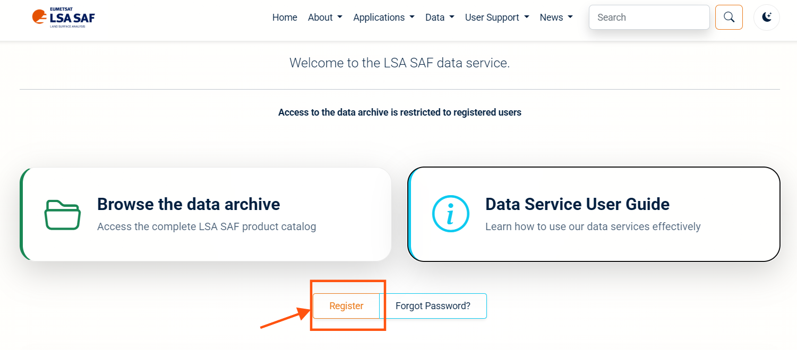
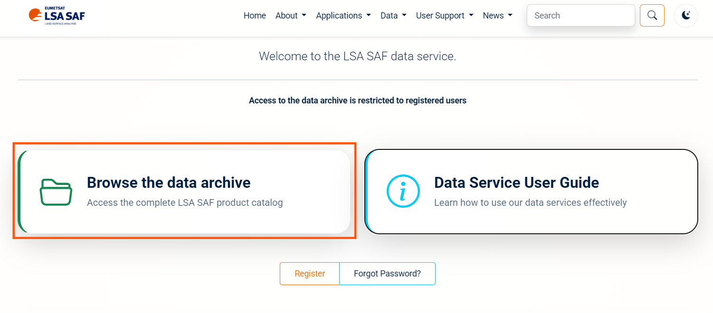

This setup guide will help you install the necessary tools and dependencies to follow and run this workshop code on your local machine unless you are using a cloud-based environment. The workshop code is designed to run in a Linux environment, so if you are using Windows, we recommend installing **Windows Subsystem for Linux (WSL2)**. If you are using macOS or Linux, you can skip the WSL installation and use your native terminal.


## 1. Install WSL2 and Ubuntu

1. Open the Windows **Start** menu, search for **PowerShell**, and choose **Run as administrator**.
2. Run the following command **in Windows PowerShell**:

```powershell
wsl --install -d Ubuntu
```

3. Restart Windows if prompted.
4. Launch **Ubuntu** from the Start menu and wait for first-time initialization.
5. Create your Ubuntu username and password when prompted. Password characters are not displayed while typing.

Check installation in **Windows PowerShell**:

```powershell
wsl --list --verbose
```

You should see `Ubuntu` with `VERSION` equal to `2`. If Ubuntu is version 1, use:

```powershell
wsl --set-version Ubuntu 2
```

If `wsl --install` displays help instead of installing, try `wsl --list --online`, then `wsl --install -d Ubuntu`. If installation is blocked by policy or virtualization, contact your IT administrator. Do not attempt to bypass institutional restrictions.

**Official guide:** <https://learn.microsoft.com/en-us/windows/wsl/install>

## 2. Install Visual Studio Code

If you do not have **VS Code** installed, follow these steps:

1. Download VS Code for Windows: <https://code.visualstudio.com/download>.
2. Install VS Code **on Windows** (not inside Ubuntu).
3. Open VS Code → **Extensions** (`Ctrl+Shift+X`). Install:
   - **WSL** (Microsoft)
   - **Python** (Microsoft)
   - **Jupyter** (Microsoft)

**Official WSL + VS Code guide:** <https://code.visualstudio.com/docs/remote/wsl>

## 3. Get the repository

On Windows, open WSL2,
On Linux or macOS, use a terminal and install Git, wget, CDO and Python 3.11+ using your operating system's package manager, 

Then run:

~~~bash
sudo apt update
sudo apt install -y git wget curl ca-certificates cdo python3 python3-venv python3-pip
~~~

Keep the project inside the Linux filesystem on WSL | in your home directory (for Linux and macOS), for example:

~~~bash
mkdir -p ~/projects
cd ~/projects
git clone https://github.com/khizerzakir/tutorial-repo.git
cd tutorial-repo
~~~

Open the repository from Ubuntu/terminal with the command code dot.

~~~bash
code .
~~~


## 4. Check your tools

~~~bash
cdo -V
git --version
python3 --version
wget --version | head -n 1
~~~

If you use uv, also run uv --version. If CDO is missing, install it through your OS package manager or a conda-forge environment; CDO is not installed by uv or pip.

## 5. Install Python dependencies

The Zarr builder in this repository requires Zarr 3; use Python 3.12 or newer.

### Option A: uv

Install uv using the [official instructions](https://docs.astral.sh/uv/getting-started/installation/), then from the repository root run:

~~~bash
uv sync --locked
~~~

Check the core packages and Zarr major version:

~~~bash
uv run python -c "import xarray, zarr; print(xarray.__version__, zarr.__version__)"
~~~

### Option B: pip

~~~bash
python3 -m venv .venv
source .venv/bin/activate
python -m pip install --upgrade pip
python -m pip install -r requirements.txt
python -c "import xarray, zarr; print(xarray.__version__, zarr.__version__)"
~~~

Confirm that the printed Zarr version is 3 or newer before running the cube builder. If the environment resolves Zarr 2, use Python 3.12+ and reinstall the project dependencies.

>**Important:** Keep the virtual environment activated for subsequent terminal commands. When you open a new Ubuntu terminal, run `source .venv/bin/activate` again. Do **not** use `sudo pip install`. The `requirements.txt` must be committed to github and kept consistent with the tested `uv.lock`; pip does not read `uv.lock` automatically.

## 6. Configure LSA SAF access

1. Register on the [LSA SAF data portal](https://datalsasaf.lsasvcs.ipma.pt/) and activate your account.

   

2. Add your credentials to a `.env` file in `code/`:

Edit `code/.env` with your account credentials. The downloader expects the names  `LSASAF_USERNAME ` and  `LSASAF_PASSWORD `. Do not commit this file or include it in screenshots.


```bash
   cp code/.env.example code/.env
```

```
   LSASAF_USERNAME="username"
   LSASAF_PASSWORD="password"
```

3. Choose the products for this tutorial:
   - [METREF: Reference Evapotranspiration](https://datalsasaf.lsasvcs.ipma.pt/PRODUCTS/MSG/METREF/)
   - [FVC: Fractional Vegetation Cover](https://datalsasaf.lsasvcs.ipma.pt/PRODUCTS/MSG/MDFVC/)

   


## 7. Continue

Go to [Download and preprocess a sample](02-run-code.qmd). Run all project commands from the repository root unless the command says otherwise.
